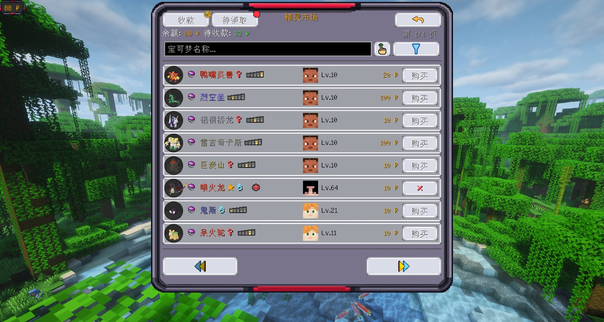
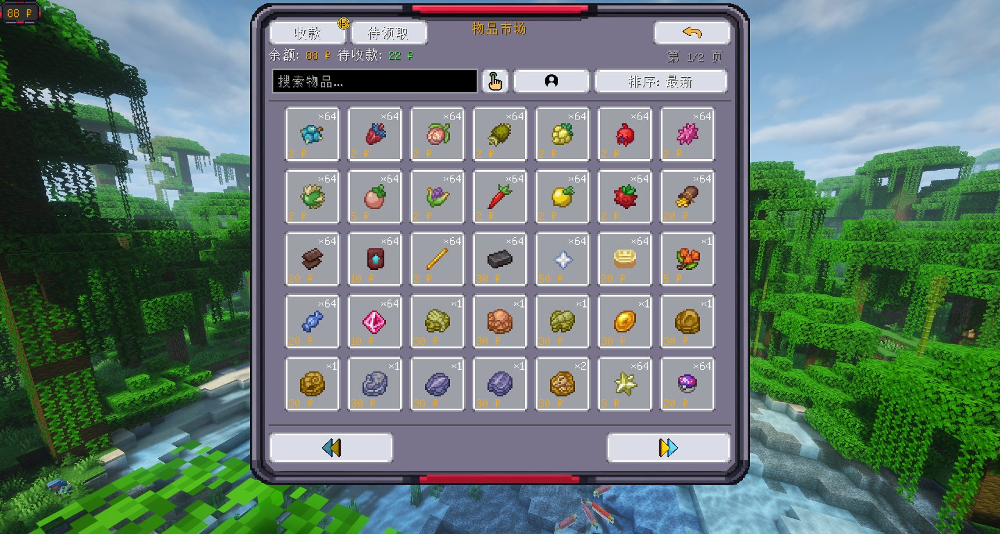
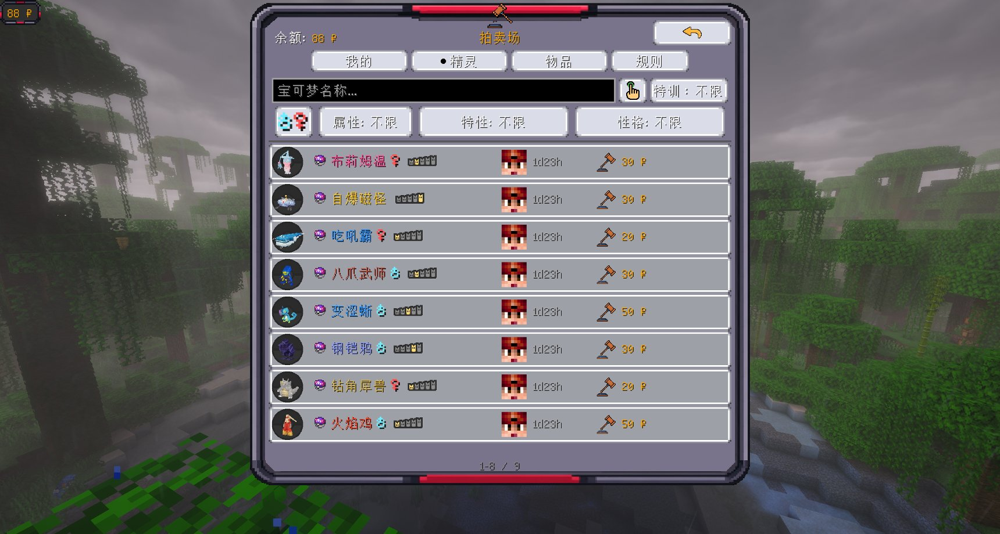
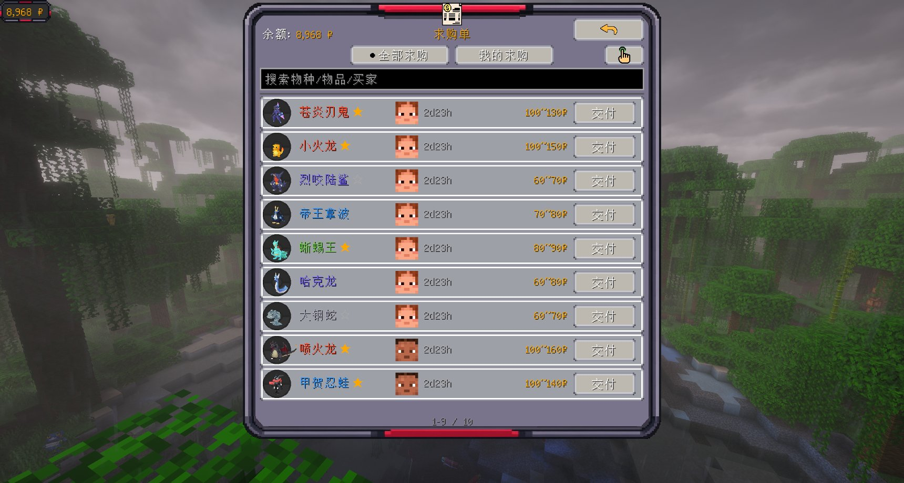
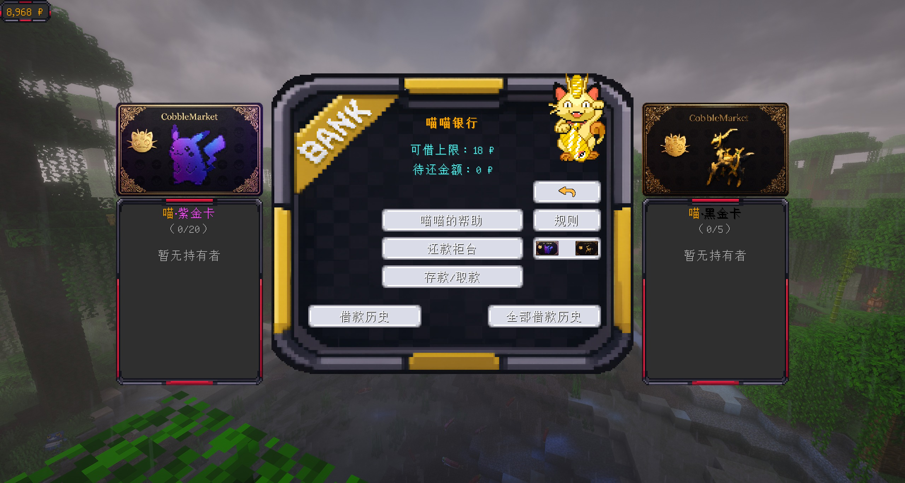
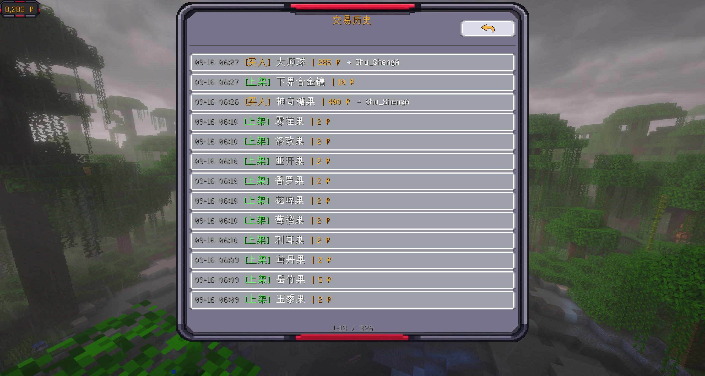

# 功能特色

CobbleMarket 把「玩家之间怎么交易」这件事做完整了 —— 从挂单、砍价、竞拍到交付、结算、对账，每一环都有对应的界面与规则。下面按功能域逐项说明。

## 精灵市场

从**队伍或 PC** 上架精灵，浏览并购买全服挂单。

- **筛选面板**：搜索框右端的「筛选」按钮打开**列表右侧的独立面板** —— 闪光、性别、属性、特性、性格、特训、个体值逐项收窄，还有一键重置；默认收起，展开时列表行数不再被挤动
- **悬停详情**：等级、球种、属性（**末尾带太晶属性**）、性格（含性格薄荷的生效性格）、特性、六项个体值（特训显示为「真实值（特训值）」）、亲密度、证章、体型、携带物；**超极巨化（含极巨等级）与初始训练家各占一行**，没有就不显示；**玩家给精灵起的昵称显示在名字下面一行**（只在悬停窗与弹窗里显示，列表行不显示）
- **精灵 3D 图标**：列表与详情里的精灵图标默认播放 Cobblemon 内置待机动画，可在设置里切回完全静态；图标会**不定期眨眼**，部分物种还会偶尔做个小动作（走路时不做、睡觉时基本不动）。**点击图标**会随机播放普通叫 / 战吼 / 战斗入场（有些物种在野外进入战斗时有专属的入场动作，如苍炎刃鬼）——只有该物种确实有这套动画时才会抽到，不会出现「只动不响」

## 物品市场

背包物品上架，买家可购买**任意数量**。

- **搜索直达变体**：支持按物品 ID、名称与完整 tooltip 文本搜索；Cobblemon 招式学习器可按招式名、附魔书可按附魔名与等级精确定位（搜「打鼾」直接找到打鼾的招式学习器）
- **完整物品词条**：所有列表与悬停使用真实物品词条，招式名、附魔名与罗马数字等级完整可见；按住 `Shift` 展开完整词条、按住 `Ctrl` 显示组件明细
- **稀有度着色**：物品名按稀有度着色，与物品栏一致
- **筛选面板**：搜索框右端的「筛选」按钮打开列表右侧的独立面板 —— 排序（最新 → 价格 ↑ → 价格 ↓）、只看自己上架的、按**创造模式分类**筛（点开是创造模式物品栏那排分类的网格，点一格只看这一类），与搜索框是「并且」关系

## 拍卖场

限时拍卖，**实时倒计时**与竞价，到期自动结算。

- **三个页签**：我的/精灵/物品；右侧筛选面板里能**排序**（最新 → 价格 ↑ → 价格 ↓ → 即将结束，三个页签通用），物品那页还能按**创造模式分类**筛
- **竞价规则**：出价立即扣款；被超价自动退回待收款；自己连续加价只补差价；不能给自己的拍卖出价；低于「当前价 + 最低加价」会被拒绝并提示
- **反狙击**：结束前 120 秒内出价会自动延长结束时间（秒数可配）
- **自动结算**：到期由服务端结算，无需有人打开界面 —— 成交进待领取、卖家收款并扣手续费，无人出价则流拍退回
- **全服播报**：上架与成交都会在聊天框播报，拍品名可悬停查看详情、点击直达出价界面 —— 悬停时**大图显示在屏幕正中**、右侧是带背景的完整信息栏（与平时悬停时一致，拍卖还会列出卖家、当前价、起拍价、最低加价、剩余时间与领先者）
- **拍卖音效**：出价确认音；结束前 10/6 / 3 秒三声渐强锤声；成交落槌与铃声（只发给参与方，不打扰围观者）

## 求购单

挂出**你想要的东西与价格**，由其他玩家交付。

- **精灵求购**：物种（留空 = 任意精灵）、闪光、特训、六项个体值（**至少**：填 20 = 20 或更高都行；已经挂着的求购单同样按新口径）、形态、特性、性格
- **物品求购**：可附带附魔等**组件要求**，交付物品不满足则被拒绝
- **资金模式**：发布时冻结「最高单价 × 数量」，成交按实际价结算并退还差价，关闭或过期自动退还
- **买家确认制**：卖家交付先进入「待确认」，货物悬空、资金不结算、重启不丢；买家看过完整货物信息后再决定接受或拒绝（拒绝可留言）
- **部分交付**：多个卖家可对同一物品单分别交付，凑满件数自动关闭

## 展示到聊天框

把自己的精灵、物品或市场 ID 卡发到全服聊天 —— 其他人**悬停那条消息就能看完整详情**（精灵与 ID 卡是完整的悬停窗，物品是完整词条）。

- **入口**：入口界面设置按钮左边的展示按钮，点开是 **精灵 / ID 卡 / 物品** 三个子按钮，选一样就发出去
- **快速展示**：按住 `X` 直接展示队伍里选中的那只精灵 / 主手拿着的那件物品（下方还会多一个 ID 卡框；按键可在「按键设置」里改）
- **冷却**：默认 **10 秒**，服务器配置界面可调（1~3600 秒；精灵 / ID 卡 / 物品三种展示共用）；服主也可以用 `shareEnabled` 整体关闭

## 市场 ID 卡

在入口界面底部点那张卡片（或按 `I`）打开**你自己的市场身份证**：左边是你的 3D 形象，右边两列列出挂单 / 拍卖 / 求购 / 待领取、余额、可借额度、欠款、存款与利息、累计成交额、图鉴遇见与捕捉数（图鉴那两行用 Cobblemon 图鉴自带的图标）。

⚠ **背景图可以换成你们服自己的**：图丢进 `config/cobblemarket/idcard/`、在服务器配置里填文件名即可（不填就用模组内置那张）。ID 卡还可以直接「展示到聊天」。

## 喵喵银行（可选金融系统）

默认关闭。开启后为服务器注入**资金流动性**，同时是服主的运营杠杆 —— 利率、额度、逾期制裁全部可配。

- **信用借贷**：按 3/6 / 12 期偿还（每 7 天一期），可用额度按玩家历史交易额自动计算，借款即时到账
- **还款柜台**：未结清借款一目了然，可「还一期」或「提前结清」（剩余本金 + 实算利息一次付清）
- **自动划扣与逾期**：每期到期自动从余额划扣（保留保底余额）；余额不足进入逾期 —— 禁止新增借款并按天累积逾期利息，还清后自动恢复
- **逾期三档制裁**：逾期 7 天手续费翻倍 → 14 天市场交易冻结 → 30 天注销为坏账（服主收到告警，可手动撤销）
- **活期存款**：闲钱存入按日计息、随时可取，存款充实准备金池形成存贷闭环；**存款 / 取款界面会显示当前余额**，日利率按实际精度显示（最多 6 位小数、自动去掉尾零）
- **喵喵支付**：购买时可选择信用消费，由服务器准备金垫付给卖家，买家分期偿还
- **卡片凭证**：喵·紫电卡/喵·金轮卡 —— 高额度凭证，额度绑定持有者而非物品（复制出的卡无效），可配置手续费减免与自行申请门槛
- **防刷设计**：额度增长冷却、同 IP 欠款上限、交易对检测、存贷利率护栏（杜绝「借钱存银行吃利息」）
- **信用账本**：借贷与还款全量写入独立 CSV 账本，中英双份按天分文件，供服主查账
- **金融管理界面（管理员）**：喵喵银行里的入口现在打开「金融管理」—— 禁止借款、卡片管理、额度管理、变更记录、额度排行五个页签；**可借上限可以人工调低 / 清零**（⚠ 不是钉死：还款与交易额增长仍会让它变化；持卡玩家的额度由卡片配置决定、不能调）；额度被调时玩家会收到含理由的通知；变更记录落在 `config/cobblemarket/finance/` 的独立账本里

## RP 系统（可选高级货币）

RP 是本模组的**高级货币**，与主货币并行流通 —— 市场 / 拍卖场 / 求购单都能二选一标价。它**不可兑换、不可转让，也不参与金融**；从哪来由服主决定（任务奖励 / 充值 / 数据包奖励，可单用可并用）。

- **玩家间 RP 交易**：独立开关（默认关）；关闭时 RP 只能单向流入（充值 / 奖励 / 兑换），玩家之间不能用 RP 买卖
- **RP 商城**：服主经营的 8×4 商品区，卖的是按规格当场生成的精灵 / 物品；精灵可配形态 / 变体 / 闪光 / 保底 V 数 / 技能槽 / 初训家等，物品可完整复制手持那件
- **四种发放路径**：`/market points give`、兑换码（本地 / 网站外部签名码）、游戏内充值（个人收款码）、数据包奖励规则
- **余额看得见**：余额 HUD 第二行、市场入口、ID 卡与玩家总览（可按 RP 余额排序）

完整说明见 [RP 系统](/points)。

## 自定义 NPC 商店

把服务器上**你自己的 NPC**（Easy NPC / Impactor / 自建实体 / 原版村民等任意实体）绑定成商店，玩家**右键那个 NPC 就打开**。商品可用**主货币或 RP** 购买，也能做成每日 / 每周 / 每月的**定期领取店**（一键领取、滚动冷却、装不下留在店里）。完整教程见[自定义 NPC 商店](/custom-shops)。

## 交易历史与账本

- **游戏内历史界面**：个人交易历史查最近 14 天账本（每人最多 500 条），管理员面板可查全服流水
- **行悬停看全**：悬停某一行时高亮并弹出这一行的完整信息 —— 长玩家名 / 长精灵名 / 长金额不再只显示截断；精灵名按主属性色、物品名按稀有度色（与市场列表同一套）
- **RP 商城成交**：交易历史与全部交易历史里，卖家栏显示成「▣ 商城」（金色）；CSV 账本末尾另有「币种」（PRIMARY / POINTS）与「来源」（market / shop）两列
- **CSV 交易账本**：市场、拍卖、求购单全链路写入，含「详情」列记录**精灵完整数据**（昵称、体型、太晶、超极巨化、初始训练家、技能、亲密度、证章都在内）与物品组件，可**精确复刻货物**
- **CSV 信用账本**：借款创建/逾期/结清事件与每笔还款的本金利息拆分，还款方式分明
- 账本**同步写盘**，不依赖自动保存，崩溃或杀进程也不丢

## 服主管理工具

- **权限节点**：市场不认 OP（`/op` 可以被任何 OP 传递）—— 谁管哪一块由服主分配，共**十四个管理节点**（含 RP 的四个与「玩家总览」）；服主名单只能手编配置文件。⚠ RP 这块同样不认 OP（商城上下架 / 兑换码 / RP 配置读写都按节点或服主判定）；「give/take 权限下放」开关默认关，打开后玩家身份的 OP 也能发任务奖励。完整教程见[权限节点](/permission)
- **全服玩家总览**：管理面板里的入口（需要「玩家总览」节点）—— 全服每人一行，显示你选中的字段值，可以搜名字、按余额 / **RP 余额** / 额度 / 借款 / 存款 / 成交额 / 图鉴数等排序；悬停某行看这个人的完整信息卡（与市场 ID 卡逐项一致，含 RP 余额行）。⚠ 离线玩家显示离线时记下的数据（行里会标注），在线的是实时值
- **黑名单**：精灵与物品双页签，可精确到**物品变体**（如只禁「锋利 V」的附魔书而不影响其它附魔书，条目按包含匹配防绕过），支持从手持物品添加、批量拉黑与按搜索结果精确解封；精灵规则可按**形态 / 变体**配（变体多选：花纹 / 饰品 / 帽子各勾各的），与形态并排三档（全部 / 形态 / 变体）
- **遵守原版「不可交易」**：Cobblemon 里被设成不可交易的精灵（原版交换界面会给它加一把锁），市场 / 拍卖 / 求购三条路径同样会拦住 —— 选精灵的界面里，那一行也会画出与原版同一把锁
- **价格限制**：可按精灵形态 / 变体、物品变体设上下限，多条目按「最具体条目优先」生效；被拦下时会提示**命中的那条规则的条件**（如「形态：不限 · 变体：愤怒馒头」），不会让玩家误以为整只精灵都被禁售。每条规则可选**主货币 / RP**（新建默认主货币），弹窗价格框右侧有货币切换按钮、列表按规则币种显示图标；精灵市场 / 物品市场 / 拍卖场 / 求购单都按**交易自己的币种**校验 —— RP 交易不再跳过限价
- **封禁**：可限时或永久封禁玩家的**市场交易**（买入 / 购买 / 上架 / 发起拍卖 / 出价 / 发布求购 / 交付 / 付钱取货），支持填写理由；**不没收已有资产**（取消挂单、领取退货与待领余额照常）；**借款默认也照常**；要禁止某人借款，去金融管理界面的「禁止借款」页签单独添加（封禁弹窗里已经没有这枚开关；存款、取款、还款始终不受影响）—— 限制范围详见[封禁管理](/moderation)
- **强制下架**：管理员面板可查看全部挂单、拍卖与求购单并强制下架，买卖双方均收到通知（离线则上线补发）
- **市场总开关**：遇到漏洞等紧急情况可一键停市（二次确认）——交易类入口（精灵市场/物品市场/拍卖场/求购单）与喵喵银行的借款入口随即置灰、点击给提示；**关市只拦交易**：设置与交易历史照常可用，喵喵银行的存款/取款/还款与卡片申请也不受影响，但待领取、领余额与下架要等市场恢复（资产不会丢失）；服主与持有对应权限节点的管理员仍可进管理员面板清理（OP 也能看到入口，功能同样按节点判定）
- **服务器配置界面**：费率、上限、时长、开关等直接在游戏内编辑，无需改配置文件
- **服务器列表**：装了本模组的服务器可以提交到[官网服务器列表](/servers)（需人工审核）—— 玩家能按平台 / 语言 / 玩法找到你的服

## 其他特色

- **「非法」标记在交易各界面可见**：RP 商城里被服主标过「非法」的精灵（数据包自己标的也算）离开商城后仍然认得出 —— 图标右上角一枚「非法」印章，选精灵上架 / 创建拍卖 / 待领取 / 精灵市场 / 拍卖场 / 管理员面板的列表行与弹窗都显示；与「不可交易」的锁左右对称，判定读精灵自己身上的标记，老挂单 / 老拍卖不用重新上架
- **大木博士**：入口界面常驻立绘，头顶气泡随机展示宝可梦冷知识（内置 498 条中英双语，可自行增删替换）
- **上架通知气泡**：别人在市场挂单 / 拍卖场上架时，屏幕顶部弹一个圆形气泡（画着刚上架的那只精灵 / 那件物品）并响一声提示音；自己上架不提示。设置里可分别关闭通知图标与提示音
- **离线通知**：玩家不在线时的交易通知自动入队，上线后按玩家语言补发
- **余额 HUD**：左上角常驻显示市场余额，可拖动到屏幕任意位置并自动吸附对齐；开启 RP 后同一框里多一行 RP（两行同显同隐）
- **列表加载状态**：拍卖场 / 求购单 / 待领取 / 交易历史 / 黑名单 / 封禁 / 权限等列表界面，首包回来前显示「加载中…」，不再把「还没收到数据」误报成「暂无」
- **滚动条可拖动**：所有带滚动条的列表都能按住滑块拖动、点轨道空白直接跳转，滚轮照旧可用
- **界面尺寸**：设置里可单独调本模组界面的缩放（六档：自动 / 1~5，默认 3）—— 只影响本模组的界面，聊天框与其他模组不受影响；「自动」= 完全跟随原版
- **全服累计成交额**：入口界面展示服务器经济规模
- **极限特训显示**：特训后的个体值显示为「真实值（特训值）」，判定按有效值
- **容器内容校验**：黑名单、价格限制与蛋交易开关对潜影箱等容器内的物品同样生效
- **精灵蛋交易**：兼容 Cobbreeding（默认关闭，需服主开启并二次确认）
- **配置热重载**：`/market reload` 应用配置修改，免重启
- **数据备份**：每次启动校验数据文件，损坏时自动从 `.bak` 恢复；无备份可用时保留 `.dat.corrupt` 供人工修复

---

想了解每个功能的细节规则与配置？见 [配置参考](/config) 与 [更新日志](/changelog)。
